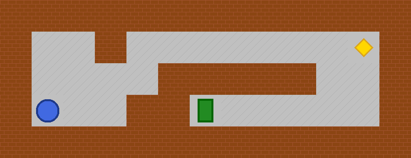
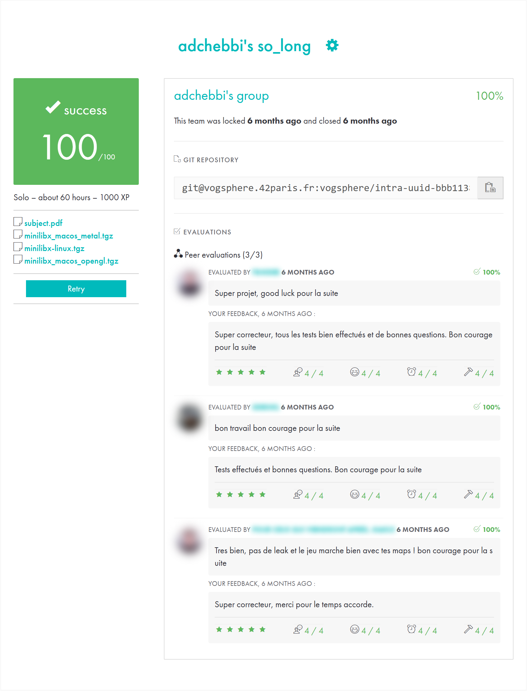

*This project has been created as part of the 42 curriculum by adchebbi.*

# so_long

> A small top-down 2D game in C with the MiniLibX graphics library: collect every item, then reach the exit.
> Maps are parsed from `.ber` files and validated with a flood-fill path check.

   



*`maps/test.ber` drawn with the game's 64×64 textures: player (blue), collectible (yellow), exit (green).*

## Highlights

- **Map validation pipeline**: rectangular shape, closed walls, allowed characters, exactly one `P` and one `E`,
  at least one `C`, then a **flood fill** on a copy of the grid to make sure every collectible and the exit are
  reachable.
- **Event-driven rendering**: MiniLibX key and window-close hooks, tile-based rendering of XPM sprites.
- **Clean resource management**: every image, the window, the display and the map are freed on exit *and* on
  every error path. Valgrind reports no leaks from project code.
- **One-command build**: the Makefile clones and builds MiniLibX automatically if it is missing.

## Build & Run

Linux / WSL dependencies for MiniLibX:

```bash
sudo apt-get update && sudo apt-get install xorg libxext-dev zlib1g-dev libbsd-dev
```

```bash
make                    # clones MiniLibX if needed, builds libft, MLX, then so_long
./so_long maps/test.ber
```

Other targets: `make clean`, `make fclean`, `make re`.

## Controls

| Key | Action |
|---|---|
| `W` / `↑` | Move up |
| `A` / `←` | Move left |
| `S` / `↓` | Move down |
| `D` / `→` | Move right |
| `ESC` or close button | Quit |

The move counter is printed in the terminal after each step.

## Map format (`.ber`)

| Char | Meaning |
|---|---|
| `1` | Wall |
| `0` | Floor |
| `P` | Player start (exactly one) |
| `E` | Exit (exactly one, opens once every `C` is collected) |
| `C` | Collectible (at least one) |

```
1111111111111
10010000000C1
1000011111001
1P0011E000001
1111111111111
```

The `maps/` folder also contains **invalid maps** used for testing: no walls, no player, two players, unreachable
items, non-rectangular shape, and others.

## Project structure

```
.
├── Makefile
├── include/
├── libft/          # personal C library (with ft_printf)
├── maps/           # valid and invalid test maps
├── textures/       # 64×64 XPM sprites
└── src/
    ├── main.c
    ├── parsing.c     # read the .ber file into a grid
    ├── map_check.c   # shape, walls, element counts
    ├── flood_fill.c  # reachability of every C and the E
    ├── game_init.c   # MLX init, window, sprite loading
    ├── render.c      # tile rendering
    ├── movement.c    # key handling, collisions, win condition
    └── cleanup.c     # free everything, on exit and on error
```

## Resources

- [MiniLibX documentation (42 Docs)](https://harm-smits.github.io/42docs/libs/minilibx)
- [MiniLibX Linux repository](https://github.com/42Paris/minilibx-linux)
- [X11 events reference](https://tronche.com/gui/x/xlib/events/)

### AI usage

Claude (Anthropic) was used as a collaborative coding assistant for:

- **Architecture design**: splitting the project into parsing, validation, rendering, movement and cleanup modules.
- **Code writing**: implementing each module, reviewed and understood line by line.
- **Debugging**: norminette violations, memory leaks and logic errors.
- **XPM textures**: generating the 64×64 pixel-art sprites with a Python script.
- **README writing**.

All code was reviewed and tested by hand, with Valgrind and with multiple valid and invalid maps.

## 42 evaluation

Validated at **100/100** by 3 peer evaluations.
Other students' names and photos are blurred.

<p align="center"></p>

## Author

**Adem Chebbi** ([@ademchbb](https://github.com/ademchbb)), 42 login `adchebbi`
